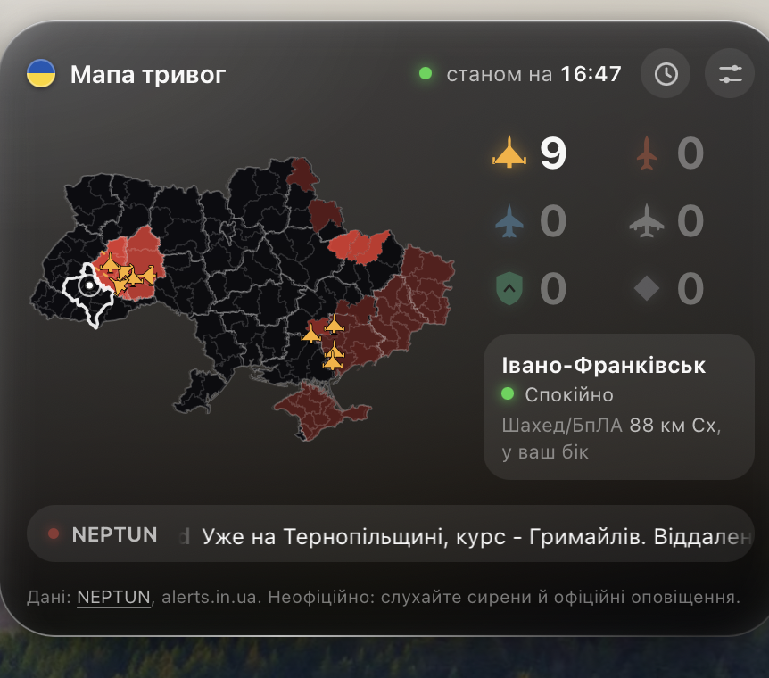

# Ukraine Alert Map — віджет повітряних тривог для macOS

Віджет для [Übersicht](https://tracesof.net/uebersicht/): показує на робочому столі повітряні тривоги в Україні по областях і районах, повітряні цілі за координатами й курсом, стрічку повідомлень та історію, а також надсилає сповіщення, коли тривога або ціль наближається до вашого міста.

*English: a desktop widget for macOS ([Übersicht](https://tracesof.net/uebersicht/)) that shows live air-raid alerts and air targets in Ukraine, with a news-style ticker, history, and notifications. No API keys required. Unofficial: always follow official sirens.*



> Скриншоти зроблені на **тестових даних** (не реальна ситуація), форми районів на них умовні.

> ⚠️ **Це неофіційне джерело.** Дані надходять від сторонніх сервісів, можуть запізнюватися або містити помилки. Віджет **не замінює** сирени та офіційні оповіщення («Повітряна тривога», ДСНС, військові адміністрації).

## Можливості

- **Карта областей і районів** на «чорному склі» у стилі Liquid Glass (темна, світла й авто-тема).
- **Колір за типом загрози:** 🟡 жовтий — лише БпЛА (шахеди, розвідники), 🔴 червоний — ракетна небезпека або тривога без відомих цілей. Чим довше триває загроза, тим темніший колір.
- **Цілі з силуетами:** шахед, розвідувальний БпЛА, крилата й балістична ракети, КАБ, тактична та стратегічна авіація. Силует повернутий за курсом, є лінія курсу й слід; для груп — «×N».
- **Живе оновлення:** WebSocket-потік NEPTUN (зміни з'являються миттєво); якщо потік недоступний — опитування кожні 6 с.
- **Стрічка повідомлень** з Telegram-каналів (через NEPTUN) і **історія** цілей, тривог та повідомлень (клік по стрічці або по годиннику).
- **«Моє місто»:** статус вашого району/області, найближча ціль, відстань і напрямок.
- **Сповіщення macOS і звук:** початок тривоги, відбій, цілі в обраному радіусі, ціль у вашому районі. Сирену й сигнал наближення віджет генерує сам.
- **Без токенів і реєстрацій.** Усі джерела безкоштовні й відкриті.
- **Налаштування прямо у віджеті:** мова (українська/англійська), кольори, розмір, фільтри цілей, джерело тривог та ін.

## Як читати віджет

### Кольори областей і районів

| Вигляд | Значення |
|---|---|
| Чорна область | Немає тривоги й відомих цілей |
| 🟡 Жовта | У ділянці лише дрони (БпЛА) |
| 🔴 Червона | Є ракети / КАБ / стратегічна авіація, або офіційна тривога без відомих цілей |
| Яскравий світлий контур | **Офіційна тривога** діє в області |
| Темніший відтінок | Загроза триває довше (до «найтемнішого» відтінку за 1/3/6/12 год, налаштовується) |
| Штриховка | Тривога лише в частині області, а межі районів недоступні |
| Біла обводка | Ваша обрана область |

### Значки й лічильники

| Значок | Що це |
|---|---|
| Жовтий «дельта-літак» | Шахед/БпЛА (за формою схожий на Герань-2) |
| Світло-жовтий літак | Розвідувальний БпЛА |
| Червоні ракети | Крилата та балістична ракети |
| Синій літак | Тактична авіація й КАБ (КАБ має окремий значок бомби); МіГ-31К показується приглушено як «спостереження» |
| Білий літак | Стратегічна авіація |
| Зелений щит | У цій області повідомлено про роботу ППО (число = кількість областей) |
| Сірий ромб | Цілі, які не вдалося класифікувати |
| Пунктирна «капсула» зі значками | Ціль відома лише на рівні області, без точки на карті |

> **Про ППО:** у джерелах немає окремого поля, тому щит виводиться з текстів повідомлень за останні 15 хв (слова «ППО» + «працює/збили/…» + назва області). Це наближена евристика.

## Встановлення

Потрібно: macOS (орієнтовно 13.3 і новіше; оформлення розраховане на macOS 26) та [Übersicht](https://tracesof.net/uebersicht/).

1. Завантажте та встановіть [Übersicht](https://tracesof.net/uebersicht/), запустіть його (за потреби дозвольте запуск у System Settings → Privacy & Security).
2. Завантажте віджет: [Releases](../../releases) або
   ```bash
   git clone https://github.com/Sandeymq/Air-raid-widget.git
   ```
3. Натисніть іконку Übersicht у рядку меню → **Open Widgets Folder**.
4. Скопіюйте папку віджета (`Air-raid-widget`, у ній має лежати `index.js`) у цю теку. Віджет з'явиться на робочому столі автоматично.

### Щоб працювали кліки (історія, налаштування)

Übersicht за замовчуванням пропускає кліки «крізь» віджети. Щоб натискати кнопки:

1. Übersicht → **Preferences** → задайте **Interaction shortcut**.
2. Дайте Übersicht доступ у System Settings → Privacy & Security → **Accessibility**.
3. Утримуйте цю комбінацію клавіш, коли клікаєте по віджету.

Без цього віджет усе одно працює й показує дані; недоступні лише панелі.

### Положення на екрані

У `index.js` у блоці `style` змініть `top` і `right`. Розмір картки змінюється в налаштуваннях (80–140 %), а не через `width`.

## Налаштування

Кнопки в шапці: 🕒 — історія, ⚙︎ — налаштування. Зміни зберігаються локально; **Reset** повертає значення за замовчуванням із блоку `config` у `index.js`.

**Display**
- Мова (English / Українська), тема (Dark / Light / Auto), палітра (Ember / Classic)
- Alert colors: *By threat* (жовтий — БпЛА, червоний — ракети) або *Always red*
- Darkest after — за скільки годин колір стає найтемнішим (1/3/6/12)
- Targets — які категорії цілей показувати й рахувати
- Size (80–140 %), Counters only (компактний режим)
- Districts (райони), Hatch partial alerts, Course and trails, Ticker (стрічка — тут її можна вимкнути), швидкість стрічки

**Data**
- Alerts from: *Auto* (NEPTUN, а якщо мовчить — Ubilling) / NEPTUN / Ubilling / Klymenko / JAAM
- Min. confidence (мінімальна достовірність цілей NEPTUN), Keep history (6/24/72 год)
- Live stream (WebSocket), Observations (спостереження, напр. зліт МіГ-31К), Stale tracks (застарілі треки)
- Рядок статусу: стан кожного джерела, потоку (з «останній кадр N с тому») і кількість завантажених районів

**Notify**
- Notifications (головний перемикач), Sound, тип звуку (Siren / System)
- My region та My place (≈75 міст) — **лише локально**, нікуди не передаються
- Alert starts, All clear, Targets near me, радіус (25/50/100/150 км)
- Кнопки: Send test, Test siren, Test approach

**Лише у файлі `index.js` (блок `config`):** `soundUrlAlert` / `soundUrlNear` (свій звук за прямим URL), `extrapolateMaxSec`, `staleAfterSec`, `offlineAfterSec`, а також `refreshFrequency`.


## Сповіщення і звук

- Банер надсилається через macOS (`osascript`). Якщо банера немає: **System Settings → Notifications → Script Editor → Allow Notifications**. Перевірити можна кнопкою *Send test*.
- Також у віджеті на ~25 с з'являється червоний банер (клік закриває його).
- Що сповіщає: початок тривоги або загрози у вашій області/районі, відбій (після ≥ 15 с без тривоги), ціль у радіусі навколо міста, ціль у вашому районі, повідомлення про ракету на вашу область.
- **Наближення:** сповіщення спрацьовує, коли ціль у радіусі **і** летить у ваш бік (курс у межах ±70° або відстань зменшується). Для балістики радіус ×3, для крилатих ракет ×2. Є два рівні: у межах радіуса та ближче ніж 1/3 радіуса.
- **Звук:** сирена (4 с) — для тривоги, ракет і дуже близьких цілей; короткий сигнал — для першого наближення дрона. Звук програється командою `afplay`, тож **він лунає й у режимі Focus**. Вимикається перемикачем *Sound*.
- Власний звук: вкажіть у `config` прямий URL аудіофайлу (`soundUrlAlert`, `soundUrlNear`); файл завантажиться один раз. Використовуйте лише файли, на які у вас є права.

## Джерела даних і приватність

| Джерело | Що дає | Примітка |
|---|---|---|
| [NEPTUN](https://neptun.in.ua/developers) | Цілі (координати, курс, швидкість, тип), тривоги по районах/областях, повідомлення з Telegram, межі районів | REST + WebSocket, без ключа. **За умовами NEPTUN у віджеті є видиме посилання на сервіс.** |
| [Ubilling](https://wiki.ubilling.net.ua/doku.php?id=aerialalertsapi) | Тривоги по областях (запасне джерело; також Klymenko та JAAM) | Без ключа |

**Приватність:** у віджеті немає аналітики й облікових записів. Він звертається лише до `neptun.in.ua` та `ubilling.net.ua` (і до вашого URL, якщо ви самі задасте власний звук). Ваша область і місто зберігаються лише в локальному сховищі віджета й нікуди не надсилаються (відстань до цілей рахується на вашому Mac).

Локальні файли: кеш і звуки в `/tmp/ukraine-alert-widget/`; налаштування, історія й кеш меж районів — у `localStorage` Übersicht (`uaw.settings.v3`, `uaw.history.v1`, `uaw.raions.v1`).

## Як це працює

1. Shell-команда (`curl`) раз на 6 с отримує цілі, тривоги, повідомлення й запасне джерело. Поки живий WebSocket, цілі не опитуються, а надходять потоком.
2. Дані зводяться в модель: рівень області (за типом цілей і офіційною тривогою), райони, цілі, лічильники.
3. Положення цілей між оновленнями екстраполюється за курсом і швидкістю (до 5 хв).
4. Межі районів завантажуються з NEPTUN раз на тиждень, стискаються, спрощуються й кешуються.
5. Якщо зв'язку немає довше 2 хв, віджет показує «Data unavailable» і прочерки замість нулів — **ніколи не показує «спокійно», коли даних немає**.

## Обмеження

- Кольори за типом загрози обчислюються **для області**, а не для кожного району окремо.
- Рівня «жовта загроза» як окремого офіційного статусу немає: жовтий тут означає «лише дрони».
- Час початку тривоги в Ubilling не завжди доступний; тоді відлік темніння йде від моменту, коли віджет вперше її побачив.
- Тексти ППО й назви областей у повідомленнях розпізнаються евристично.
- Якість і швидкість даних залежать від зовнішніх сервісів (волонтерські проєкти, без гарантій).

**Стан тестування.** Віджет створено за допомогою ШІ. Автоматичні перевірки (логіка, інтерфейс, сповіщення, WebSocket, shell-скрипт) виконувались на змодельованих даних у браузері; поведінка в реальному Übersicht на macOS і з живими API може відрізнятися. Знайшли помилку — створіть Issue.

## Усунення несправностей

| Проблема | Що робити |
|---|---|
| Кнопки не реагують | Задайте *Interaction shortcut* і дайте доступ Accessibility (див. вище) |
| Немає банера сповіщення | System Settings → Notifications → Script Editor → Allow. Перевірте Focus |
| Немає звуку | Перевірте гучність і перемикач *Sound*; натисніть *Test siren* |
| «Data unavailable» | Немає інтернету або сервіси недоступні; перевірте Data → статус джерел |
| «stream: reconnecting» | Потік недоступний, віджет працює на опитуванні (6 с); це нормально |
| Районів немає («districts: …») | Межі завантажуються у фоні при першому запуску; зачекайте хвилину. Не допомагає — видаліть `/tmp/ukraine-alert-widget/` і дочекайтесь оновлення. Тим часом область штрихується |
| Хочу скинути все | Data → **Reset** |
| Віджета не видно | Перевірте, що Übersicht запущений і папка з `index.js` лежить у теці віджетів |

### Споживання ресурсів

Віджет легкий, але має анімації (біжуча стрічка, пульсація) й розмиття фону. Щоб зменшити навантаження: вимкніть *Ticker*, увімкніть *Counters only* або вимкніть *Districts*; у System Settings → Accessibility → Display увімкніть *Reduce motion*; збільшіть `refreshFrequency` (не менше 5000 мс — так просить NEPTUN).

## Видалення

Видаліть папку віджета з теки Übersicht та, за бажання, `/tmp/ukraine-alert-widget/`. Дані в `localStorage` очищуються кнопкою **Reset**.

## Походження, подяки та ліцензія

- Проєкт починався як доопрацювання віджета **[dr-mod/air-raid-widget-macos](https://github.com/dr-mod/air-raid-widget-macos)** (MIT, © 2022 Dmytro Panin). Код цієї версії переписано; від вихідної версії лишилися ідея, формат віджета Übersicht та контури областей.
- Дані: [NEPTUN](https://neptun.in.ua/), [Ubilling](https://wiki.ubilling.net.ua/doku.php?id=aerialalertsapi).
- Платформа: [Übersicht](https://tracesof.net/uebersicht/).

Ліцензія: [MIT](LICENSE). Збережено сповіщення про авторські права оригінального проєкту.
